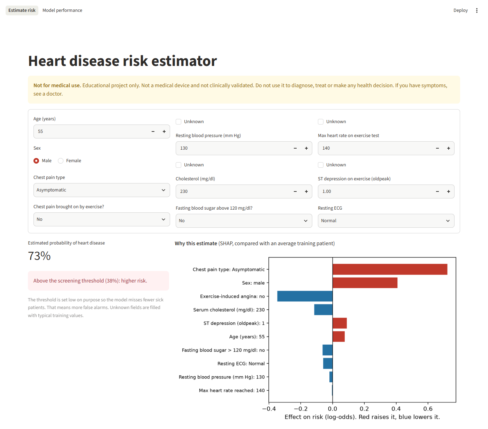
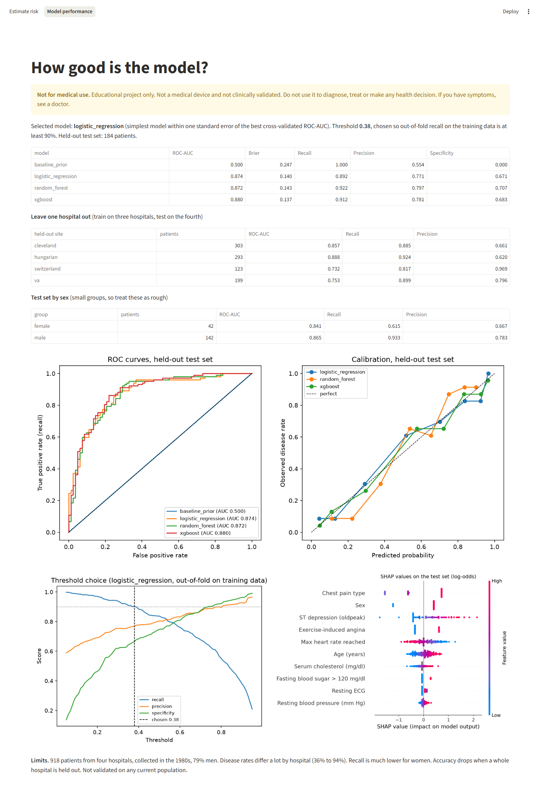

# Heart disease risk prediction

[](https://github.com/ashiqahamed178-dotcom/Heart-Disease-Prediction/actions/workflows/ci.yml)

**Live demo:** https://heart-disease-prediction-ru8mzqsacqmemgmamuyzrr.streamlit.app/
(free hosting, so if it has been idle it may take about 30 seconds to wake up)

An end-to-end machine learning project on the UCI Heart Disease data: a reproducible
training pipeline, a Streamlit app that explains every prediction with SHAP, and a small
FastAPI service. It is tested, type-checked, linted, containerised and runs in CI.

> **Not for medical use.** This is an educational portfolio project. It is not a medical
> device, has not been clinically validated, and must not be used to make any health decision.



## Results

All numbers come from `python -m heartrisk.train` and are saved in
[`models/metrics.json`](models/metrics.json) and [`reports/results.md`](reports/results.md).
The test set is 184 patients (20%) that were never used for tuning, model choice or
picking the threshold.

| Model (held-out test set) | ROC-AUC | Brier | Recall | Precision | Specificity |
|---|---|---|---|---|---|
| Baseline (always predict the base rate) | 0.500 | 0.247 | 1.000 | 0.554 | 0.000 |
| **Logistic Regression (selected)** | **0.874** | **0.140** | **0.892** | **0.771** | **0.671** |
| Random Forest | 0.872 | 0.143 | 0.922 | 0.797 | 0.707 |
| XGBoost | 0.880 | 0.137 | 0.912 | 0.781 | 0.683 |

Recall, precision and specificity are at each model's own threshold, chosen the same way
(see below).

- **95% bootstrap interval for the selected model:** ROC-AUC 0.82 to 0.92, recall 0.83
  to 0.95, precision 0.69 to 0.84.
- **The three real models are effectively tied.** Their 5-fold CV ROC-AUCs are 0.876,
  0.876 and 0.874, and their test ROC-AUCs fall well inside each other's intervals.
  XGBoost's slightly higher test AUC is within noise.
- **Recall is much lower for women** (0.615 against 0.933 for men). See below.
- **Recall on the test set (0.892) is just under the 0.90 target.** The threshold was fixed
  on training data, and 102 positive test cases is a small sample. It missed 11 of the 102.

### Does it travel to a new hospital?

Training on three hospitals and testing on the fourth is the most honest check here,
and it shows the model's main weakness:

| Held-out hospital | Patients | ROC-AUC | Recall | Precision |
|---|---|---|---|---|
| Cleveland | 303 | 0.857 | 0.885 | 0.661 |
| Hungary | 293 | 0.888 | 0.924 | 0.620 |
| Switzerland | 123 | 0.732 | 0.817 | 0.969 |
| VA Long Beach | 199 | 0.753 | 0.899 | 0.796 |

ROC-AUC drops to about 0.73 to 0.75 on Switzerland and VA. Switzerland has only 8 patients
without disease, so its AUC is very noisy.

### Test set by sex

| Group | Patients | With disease | ROC-AUC | Recall | Precision |
|---|---|---|---|---|---|
| Women | 42 | 13 | 0.841 | **0.615** | 0.667 |
| Men | 142 | 89 | 0.865 | 0.933 | 0.783 |

**This is the clearest weakness found.** At the shared threshold the model caught 8 of 13
women with disease but 83 of 89 men. Ranking quality (ROC-AUC) is similar, so the gap
most likely comes from the threshold: being female lowers the predicted risk, so sick
women are less likely to reach 0.38. With only 13 positive women the exact figure is very uncertain, but the
direction is a real warning. A fix to try would be a per-group threshold or more data on
women, checked on new data. I have not tuned anything to make this table look better.



## How it works

### Data

The four "processed" files from the
[UCI Heart Disease dataset](https://archive.ics.uci.edu/dataset/45/heart+disease)
(Cleveland, Hungary, Switzerland, VA Long Beach): 920 patients, 918 after removing 2
duplicates. `heartrisk.data` downloads them from UCI and falls back to a byte-identical
mirror pinned to one commit (UCI was unreachable while this was built). Both sources are
checked against fixed SHA-256 hashes, so the data cannot silently change.

The target is `num > 0`, meaning more than 50% narrowing of a major vessel on angiography.
55% of patients have it.

### Data decisions, and the leakage they avoid

| Issue found | What I did | Why |
|---|---|---|
| `ca`, `thal` and `slope` are 51% to 99% missing outside Cleveland | Dropped them | Imputing mostly-missing columns adds noise, and their missingness mainly tells the model which hospital a patient came from |
| Cholesterol is 0 for all 123 Swiss patients (and 49 VA patients) | Treated 0 as missing | Swiss patients are 94% positive, so "cholesterol = 0" would be a hospital shortcut, not a medical signal |
| One resting blood pressure of 0 | Treated as missing | Not physically possible |
| Disease rate ranges from 36% to 94% by hospital | Hospital is never a feature; it is only used to stratify the split and for the leave-one-hospital-out check | Using it would inflate scores and would not work on a new hospital |
| Missing values | Median or most-frequent imputation inside the pipeline, so it is fitted on training folds only | Fitting on all data would leak test information |

No missing-value indicator columns are added, because which values are missing mostly
depends on the hospital.

The 10 features used: age, sex, chest pain type, resting blood pressure, cholesterol,
fasting blood sugar, resting ECG, max heart rate, exercise-induced angina and ST depression.

### Training and model choice

1. Stratified 80/20 train/test split on hospital and label together.
2. For each model, a small grid search with 5-fold stratified CV on the training set,
   scored by ROC-AUC.
3. **Model choice: the one-standard-error rule.** Pick the simplest model whose mean CV
   ROC-AUC is within one standard error of the best. All three were within it, so
   Logistic Regression won. It is also the easiest to explain and to check.
4. **Threshold choice: recall first.** Missing a sick patient is worse than a false alarm,
   so the threshold is the highest one that still catches at least 90% of positive cases
   in out-of-fold training predictions. That gives **0.38** instead of the default 0.5. On
   the test set this moves recall from 0.853 to 0.892, and specificity drops from 0.744 to
   0.671.
5. Final scoring on the untouched test set, with bootstrap intervals, plus the
   leave-one-hospital-out and by-sex checks.

### Calibration

Brier score is 0.140 for the selected model, against 0.247 for the baseline. Expected
calibration error (ECE) is 0.084, which is reasonable but not exact; XGBoost's is 0.035. So
treat a displayed "73%" as a rough level of risk, not a precise probability. See
`reports/figures/calibration_test.png`.

### Explanations

SHAP values are computed for the whole pipeline, including imputation and one-hot encoding,
so each of the 10 input fields gets one contribution in log-odds. The contributions add up
exactly to the patient's log-odds minus the average (a test checks this). This works the
same whichever model is selected.

Across the test set, the strongest drivers are chest pain type (asymptomatic chest pain is
the highest-risk group in this data), sex, ST depression, exercise-induced angina and max
heart rate. These match the known clinical picture, which is a useful sanity check, but
they show what the model learned from this data and are not causal.

## Limitations

- **Small and old data.** 918 patients from four hospitals, collected in the 1980s.
  Diagnosis, treatment and populations have changed since.
- **Not a screening population.** These patients were referred for angiography, so 55% have
  disease. Risk in the general population is much lower, and the probabilities would not
  transfer.
- **Bias against women.** 79% of patients are men, and sex is the second-strongest feature.
  On the test set, recall for women is 0.615 against 0.933 for men (13 and 89 positive
  cases). The data has no ethnicity information, so performance across ethnic groups is
  unknown.
- **Hospital shift.** Accuracy drops on an unseen hospital (ROC-AUC about 0.73 to 0.75 for
  two of the four).
- **Missing data.** Several fields are often missing and are filled with typical values.
  Three useful clinical fields (`ca`, `thal`, `slope`) had to be dropped.
- **No clinical validation** of any kind, and no prospective testing.

## Run it

Requires Python 3.12 or newer (built and tested on 3.14). Everything is free and runs locally.

```bash
python -m venv .venv
```

```bash
.venv\Scripts\activate
```

(On macOS or Linux: `source .venv/bin/activate`.)

```bash
pip install -r requirements-dev.txt && pip install --no-deps -e .
```

Retrain (downloads the data, about 3 minutes on a laptop, rewrites `models/` and `reports/`):

```bash
python -m heartrisk.train
```

Start the app at http://localhost:8501:

```bash
streamlit run app/streamlit_app.py
```

Start the API at http://localhost:8000 (interactive docs at `/docs`):

```bash
uvicorn heartrisk.api:app --reload
```

```bash
curl -X POST localhost:8000/predict -H "Content-Type: application/json" -d "{\"age\":61,\"sex\":1,\"cp\":4,\"trestbps\":140,\"chol\":260,\"exang\":1,\"oldpeak\":2.0}"
```

Optional fields that are left out are treated as unknown. The response has the
probability, the high-risk flag, the threshold, each feature's SHAP contribution and the
disclaimer.

Checks (the same ones CI runs):

```bash
ruff check . && ruff format --check . && mypy && pytest
```

### Docker

```bash
docker build -t heartrisk .
```

```bash
docker run -p 8501:8501 heartrisk
```

For the API instead: `docker run -p 8000:8000 heartrisk uvicorn heartrisk.api:app --host 0.0.0.0 --port 8000`.

### Free hosting

The [live demo](https://heart-disease-prediction-ru8mzqsacqmemgmamuyzrr.streamlit.app/) runs on
[Streamlit Community Cloud](https://streamlit.io/cloud) at no cost. To host your own copy, point
it at this repository with `app/streamlit_app.py` as the main file. It installs
`requirements.txt` and uses the committed model, so no training is needed there.

## Project layout

```
src/heartrisk/
  config.py     paths, feature lists, fixed settings
  data.py       download with checksum, load, clean
  models.py     preprocessing and model pipelines, tuning grids
  evaluate.py   metrics, threshold choice, calibration error, bootstrap intervals
  explain.py    SHAP for the whole pipeline
  train.py      the end-to-end training run
  predict.py    input validation (pydantic) and single-patient prediction
  api.py        FastAPI service
app/streamlit_app.py   the web app
tests/                 pytest suite (no network needed)
models/                trained model and metrics (committed so the app works out of the box)
reports/               results table and figures
scripts/screenshots.py README screenshots (needs Playwright, dev only)
```

CI (GitHub Actions) runs lint, format check, type check and tests with coverage, then builds
the Docker image and sends a real prediction request to the API inside it. A manual
workflow run can also retrain from scratch.

## Data source and licence

Janosi, A., Steinbrunn, W., Pfisterer, M. and Detrano, R. (1988). *Heart Disease*. UCI
Machine Learning Repository. https://doi.org/10.24432/C52P4X. Licensed CC BY 4.0. The
data is downloaded at run time and is not stored in this repository.

Code: MIT licence.
